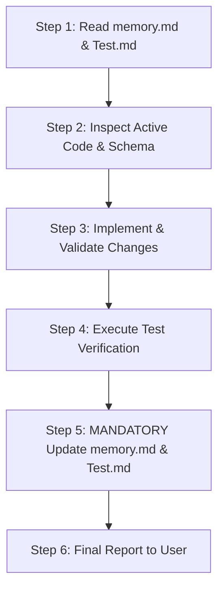

# 🤖 Agent Operational Guidelines & Mandatory Protocols (`Agents.Md`)
> **Standard Operating Procedures for AI Agents Working on the eYogi Ecosystem**  
> *Applicable to: Claude, Gemini, Antigravity, GitHub Copilot, and any AI Coding Assistant*

---

## 🚨 MANDATORY PROTOCOL: POST-CHANGE UPDATES

> [!CAUTION]
> ### 🛑 STRICT DIRECTIVE FOR ALL AGENTS
> **AFTER EVERY CODE CHANGE, REFACTORING, BUG FIX, OR SYSTEM MODIFICATION, YOU MUST IMMEDIATELY UPDATE TWO FILES:**
> 1. [memory.md](file:///Users/prashant/Documents/Application%20directory/eyogi-main/memory.md) — Document any architectural changes, new collections/components/routes, database schema changes, configuration updates, or discovered gotchas.
> 2. [Test.md](file:///Users/prashant/Documents/Application%20directory/eyogi-main/Test.md) — Document any new or updated test scenarios, test execution results, pass/fail status updates, and defect logs.
>
> **NO PULL REQUEST, COMMIT, OR USER-FACING COMPLETION MESSAGE IS PERMITTED WITHOUT FIRST SATISFYING THIS PROTOCOL.**

---

## 1. Dual-Project Awareness: eyogi vs. ssh

This repository is **NOT** a simple monolithic web app. It is a dual-project repository containing two distinct web applications with differing runtimes, React versions, and backends:

```
┌─────────────────────────────────────────────────────────────────────────────┐
│                             eYogi Ecosystem                                │
├──────────────────────────────────────┬──────────────────────────────────────┤
│ Project 1: eyogi (Root Directory)    │ Project 2: ssh (src/SSH/ Directory)  │
├──────────────────────────────────────┼──────────────────────────────────────┤
│ • Next.js 15.1.9 (App Router)        │ • Vite 7.2.2 SPA                     │
│ • React 19.0.0                       │ • React 18.3.1                       │
│ • PayloadCMS 3.9.0                   │ • Supabase (Auth, RLS, Realtime, DB) │
│ • Neon PostgreSQL (Serverless)       │ • Tailwind CSS 4.1                   │
│ • UploadThing Media CDN              │ • jsPDF / html2canvas / CryptoJS     │
│ • Tailwind CSS 3.4 + Radix UI        │ • Express local server (server.mjs)  │
│ • Root public website & CMS admin    │ • Gurukul University LMS (4 portals) │
│ • Serves root domain (/)             │ • Deployed to /ssh-app/ via rewrites │
└──────────────────────────────────────┴──────────────────────────────────────┘
```

### Critical Development Rules for the Dual Projects:
1. **Never Mix Package Managers or Install React 19 in SSH**:
   - The root project uses **React 19** with Yarn resolutions.
   - `src/SSH` relies on **React 18** (compatible with React Quill, React PDF, and older React ecosystems).
   - **Never run a blind `npm install` at root** without understanding React 19 peer dependencies. Always use `yarn` at root.
2. **Never Edit `public/ssh-app/` Directly**:
   - `public/ssh-app/` is a generated artifact created by `node copy-ssh-files.js` from `src/SSH/dist/`.
   - Editing files in `public/ssh-app/` directly is an anti-pattern; changes **will be overwritten** on subsequent builds.
   - Always make code changes inside `src/SSH/` and compile via `yarn build:ssh`.
3. **Database Segregation**:
   - Website content, blogs, dynamic pages, FAQs, and CMS admin users belong in **Neon PostgreSQL** via PayloadCMS collections (`src/collections/`).
   - University LMS data (students, teachers, parents, courses, batches, enrollments, attendance, certificates, consent) belongs in **Supabase PostgreSQL** (`src/SSH/migrations/`).
   - **Never execute raw migrations without checking existing tables and RLS policies**.

---

## 2. Standard Agent Workflow Lifecycle

Every agent task must follow this 4-step sequence:



### Step 1: Pre-Implementation Context Check
- Read [memory.md](file:///Users/prashant/Documents/Application%20directory/eyogi-main/memory.md) to understand existing features, active configurations, and gotchas.
- Read [Test.md](file:///Users/prashant/Documents/Application%20directory/eyogi-main/Test.md) to verify test cases related to your assigned task.
- Check relevant schemas (`src/collections/` for CMS or `src/SSH/src/lib/supabase-types.ts` & `src/SSH/migrations/` for SSH).

### Step 2: Implementation Guidelines
- **TypeScript**: Use strict typing. Avoid `any`. Prefer Zod schemas for input validation.
- **Licensing**: Only use permissive open-source licenses (MIT, Apache 2.0, BSD). Never use GPL/AGPL or commercial proprietary libraries without explicit user sign-off.
- **Sensitive Data**: Any child or parent personal data in SSH must use `src/SSH/src/lib/encryption.ts`.
- **Accessibility & UX**: All interactive elements must support keyboard navigation (`Tab`, `Enter`, `Space`) and proper ARIA labels.

### Step 3: Verification & Quality Assurance
Run the relevant verification command before declaring completion:
- **Root changes**:
  ```bash
  npx tsc --noEmit && yarn lint
  ```
- **SSH changes**:
  ```bash
  cd src/SSH && npm run type-check && npm test && npm run lint
  ```
- **Build / Packaging changes**:
  ```bash
  yarn build
  ```

### Step 4: Mandatory Post-Change Documentation Update
1. Update [memory.md](file:///Users/prashant/Documents/Application%20directory/eyogi-main/memory.md):
   - Add new features or changes to Section 6 (**Recent Work & State Log**).
   - If collections, routes, or architecture were added, update Sections 3 or 4.
   - If any new configuration/env variables or gotchas were identified, record them.
2. Update [Test.md](file:///Users/prashant/Documents/Application%20directory/eyogi-main/Test.md):
   - Add new test cases or checklists to Section 3.
   - Update the **Test Execution Log & Status Matrix** (Section 4) with the timestamp and status.
   - If any bug was discovered during work, log it using the **Defect Reporting Template** (Section 5).

---

## 3. Specialized Agent Personas & Behaviors

When performing specific tasks, adopt the responsibilities outlined below:

### 🏗️ Architect Role
- Review existing database schema before proposing any new tables, columns, or relationships.
- Ensure clean decoupling between the PayloadCMS backend and the Supabase LMS backend.
- Evaluate bundle size impacts on Next.js Turbopack or Vite chunks.

### 💻 Code Role
- Write modular, readable TypeScript adhering to project conventions.
- Maintain consistency with existing Tailwind CSS and Radix UI / Headless UI patterns.
- Follow PayloadCMS collection hook conventions (`beforeChange`, `afterChange`, `revalidatePost`).
- Use the `cn` utility (`@/utilities/cn` or `clsx`/`tailwind-merge`) for styling compositions.

### 🐞 Bug Fixing Role
- Perform systematic root-cause analysis before touching code.
- Reproduce the issue with minimal test scripts or steps.
- Ensure fixes do not introduce regressions into the opposite project (e.g. Next.js vs Vite).

### 🧪 QA Role
- Create comprehensive test cases covering positive flows, negative boundary conditions, and edge cases.
- Run static checks (`tsc`, `eslint`) and unit/integration tests (`vitest`).
- Document all findings in [Test.md](file:///Users/prashant/Documents/Application%20directory/eyogi-main/Test.md).

---

## 4. Quick Reference Directory Map

| Path | Description |
| :--- | :--- |
| `memory.md` | Architectural state, system memory, and known gotchas (MANDATORY TO UPDATE) |
| `Test.md` | Test strategy, test suites, and execution logs (MANDATORY TO UPDATE) |
| `Agents.Md` | This file - Instructions and protocols for all agents |
| `src/app/(frontend)/` | Public Next.js website routes |
| `src/app/(payload)/` | PayloadCMS admin panel (`/admin`) |
| `src/collections/` | PayloadCMS collections (Pages, Posts, Media, etc.) |
| `src/SSH/` | SSH University (Vite + React 18 LMS platform) |
| `src/SSH/src/pages/` | SSH pages (Home, About, Courses, Gurukuls, Quiz) |
| `src/SSH/src/components/admin/` | SSH Admin & Business Admin management components |
| `src/SSH/src/components/dashboard/` | Student, Teacher, and Parent dashboards |
| `src/SSH/migrations/` | Supabase SQL schema, attendance, and RLS migration scripts |
| `public/ssh-app/` | **READ-ONLY**: Built output of SSH portal (do not manually edit) |
| `copy-ssh-files.js` | Script that copies `src/SSH/dist` to `public/ssh-app` |
