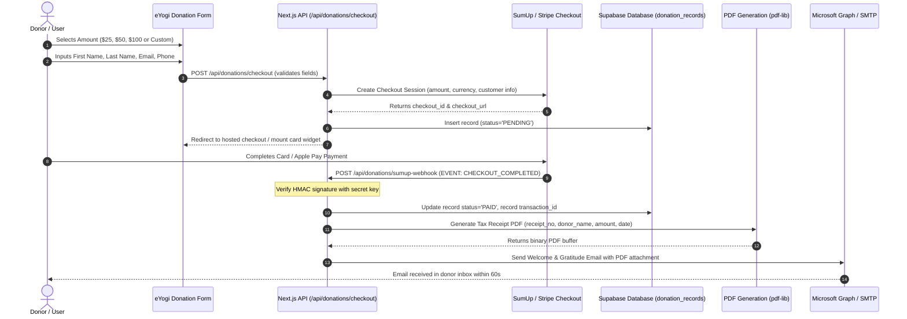

# 🏗️ System Architecture & Technical Design Document: Phase 2 Revamp (Unified Supabase Architecture)
> **Project**: eYogi Platform & SSH Gurukul University Ecosystem  
> **Document**: Technical Design Document (TDD)  
> **Version**: 2.1 (Unified Supabase & Custom CMS Architecture)  
> **Author**: Antigravity Technical Architecture Team  
> **Date**: October 20, 2026  
> **Status**: Approved for Development  

---

## 1. System Topology & Unified Supabase Architecture

In Phase 2, the ecosystem is streamlined to use a **single, unified backend**:
- **Elimination of Neon PostgreSQL & PayloadCMS**: PayloadCMS and Neon PostgreSQL are completely decommissioned.
- **Unified Backend**: **Supabase (PostgreSQL, Auth, RLS, Storage, Realtime)** serves as the single source of truth for the entire ecosystem.
- **Unified Custom CMS**: All content management (website pages, dynamic menus, media, blogs, FAQs, donations, and memberships) is consolidated into the **Custom CMS** housed within the **SSH-App Admin Portal** (`/admin/*`).
- **Public Website (`eyogi` at Root)**: Next.js 15.1.9 App Router functions as a fast, high-performance public rendering layer querying Supabase via `@supabase/supabase-js` with server-side caching (ISR) and server components.

```
┌────────────────────────────────────────────────────────────────────────────────────────┐
│                                   CLIENT BROWSERS                                      │
└───────────────────────────┬────────────────────────────────────────┬───────────────────┘
                            │ (Route: /)                             │ (Route: /ssh-app/*)
                            ▼                                        ▼
┌─────────────────────────────────────────────────────────┐  ┌───────────────────────────┐
│              PROJECT 1: eyogi (Next.js 15)              │  │  PROJECT 2: ssh (Vite 7)  │
│ • Next.js 15.1.9 App Router + React 19                  │  │ • Vite 7.2.2 + React 18   │
│ • Reads content from Supabase (Server Components + ISR) │  │ • Unified Custom CMS & LMS│
│ • WhatsApp Floating Action Button (No /contact)         │  │ • Multi-Role Switcher     │
│ • SumUp / Stripe Donation API & Webhook Handler         │  │ • Schedule & Availability │
└───────────────────────────┬─────────────────────────────┘  └─────────────┬─────────────┘
                            │                                              │
                            │             ┌──────────────────┐             │
                            └────────────►│  SumUp / Stripe  │◄────────────┘
                                          │ • Hosted Checkout│
                                          │ • Card/Apple Pay │
                                          └────────┬─────────┘
                                                   │ Webhooks
                                                   ▼
┌────────────────────────────────────────────────────────────────────────────────────────┐
│                             UNIFIED SUPABASE BACKEND                                   │
│ • PostgreSQL Database with Row-Level Security (RLS)                                    │
│ • Supabase Auth (Single Sign-On for all roles)                                         │
│ • Storage Buckets: 'public-media', 'documents', 'onboarding-secure-docs'               │
│ • Supabase Realtime Subscriptions                                                      │
├────────────────────────────────────────────────────────────────────────────────────────┤
│ Schemas & Data Tables:                                                                 │
│ 1. Website & CMS: page_settings, dynamic_menus, blog_posts, faqs, media_library        │
│ 2. Financials: donation_records, invoices, sumup_transactions                          │
│ 3. Identity: profiles, user_roles, parent_children, document_signatures                │
│ 4. Academics: courses, batches, course_schedules, teacher_availability, attendance     │
│ 5. Learning: quizzes, quiz_questions, quiz_attempts, student_badges, course_materials  │
│ 6. Governance: document_library, document_assignments, student_feedback, parent_feedback │
└────────────────────────────────────────────────────────────────────────────────────────┘
```

---

## 2. Public Portal Architecture & WhatsApp Action Component

### 2.1 Deprecation of Contact Us Page
- The standalone `/contact` route in Next.js is decommissioned.
- Navigation menus (managed via `dynamic_menus` in Supabase) remove `/contact`.

### 2.2 WhatsApp Floating Action Button
Implemented in `src/components/layout/WhatsAppStickyButton.tsx`:
- Positioned fixed: `bottom-6 right-6 z-50`.
- Includes pulse animation ring, official WhatsApp brand color (`#25D366`), accessible ARIA label, and tooltip on hover.
- Pre-filled query URL:
  ```typescript
  const whatsappUrl = `https://wa.me/${process.env.NEXT_PUBLIC_WHATSAPP_NUMBER}?text=${encodeURIComponent(
    'Namaste! I would like to inquire about eYogi Gurukul courses and activities.'
  )}`
  ```

### 2.3 Next.js Supabase Data Client
Public pages query Supabase directly via server components with Incremental Static Regeneration (ISR):
```typescript
import { createClient } from '@supabase/supabase-js'

export const supabaseServer = createClient(
  process.env.NEXT_PUBLIC_SUPABASE_URL!,
  process.env.SUPABASE_SERVICE_ROLE_KEY!
)

// Example: Fetching homepage CMS settings from Supabase
export async function getHomePageSettings() {
  const { data, error } = await supabaseServer
    .from('page_settings')
    .select('*')
    .eq('page_slug', 'home')
    .single()
  return data
}
```

---

## 3. Automated Donation Engine & Tax Receipt Pipeline

### 3.1 Data Flow Sequence



### 3.2 Supabase Schema: `donation_records`
```sql
CREATE TABLE public.donation_records (
  id UUID PRIMARY KEY DEFAULT gen_random_uuid(),
  receipt_number TEXT NOT NULL UNIQUE,
  first_name TEXT NOT NULL,
  last_name TEXT NOT NULL,
  donor_email TEXT NOT NULL,
  donor_phone TEXT NOT NULL,
  amount NUMERIC(10,2) NOT NULL,
  currency TEXT NOT NULL DEFAULT 'USD',
  frequency TEXT NOT NULL DEFAULT 'one-time', -- 'one-time', 'monthly', 'annual'
  cause TEXT DEFAULT 'General Fund',
  status TEXT NOT NULL DEFAULT 'PENDING', -- 'PENDING', 'PAID', 'FAILED', 'REFUNDED'
  gateway_provider TEXT NOT NULL DEFAULT 'sumup', -- 'sumup', 'stripe'
  gateway_transaction_id TEXT,
  gift_aid_eligible BOOLEAN DEFAULT false,
  receipt_pdf_url TEXT,
  created_at TIMESTAMPTZ NOT NULL DEFAULT timezone('utc'::text, now()),
  updated_at TIMESTAMPTZ NOT NULL DEFAULT timezone('utc'::text, now())
);

CREATE INDEX idx_donations_email ON public.donation_records(donor_email);
CREATE INDEX idx_donations_status ON public.donation_records(status);
```

---

## 4. Teacher Automated Onboarding & Mandatory NDA Workflow

### 4.1 Supabase Schema: Teacher Onboarding & Document Signing

```sql
-- 1. Teacher Onboarding Stage Enum
CREATE TYPE teacher_onboarding_stage AS ENUM (
  'registered',
  'nda_pending',
  'nda_signed',
  'admin_review',
  'approved',
  'rejected'
);

-- 2. Teacher Table Extensions
ALTER TABLE public.teachers
  ADD COLUMN IF NOT EXISTS onboarding_stage teacher_onboarding_stage NOT NULL DEFAULT 'nda_pending',
  ADD COLUMN IF NOT EXISTS is_approved BOOLEAN NOT NULL DEFAULT false,
  ADD COLUMN IF NOT EXISTS approved_by UUID REFERENCES auth.users(id),
  ADD COLUMN IF NOT EXISTS approved_at TIMESTAMPTZ,
  ADD COLUMN IF NOT EXISTS teacher_code TEXT UNIQUE;

-- 3. Electronic Signature Ledger
CREATE TABLE public.document_signatures (
  id UUID PRIMARY KEY DEFAULT gen_random_uuid(),
  user_id UUID NOT NULL REFERENCES auth.users(id) ON DELETE CASCADE,
  document_id UUID NOT NULL REFERENCES public.document_library(id),
  legal_name TEXT NOT NULL,
  ip_address TEXT NOT NULL,
  user_agent TEXT NOT NULL,
  signed_at TIMESTAMPTZ NOT NULL DEFAULT timezone('utc'::text, now()),
  signature_hash TEXT NOT NULL,
  pdf_signed_url TEXT
);

-- 4. Constraint Trigger: Prevent Course/Batch Assignment for Unapproved Teachers
CREATE OR REPLACE FUNCTION public.check_teacher_approval_before_assignment()
RETURNS TRIGGER AS $$
BEGIN
  IF NOT EXISTS (
    SELECT 1 FROM public.teachers
    WHERE id = NEW.teacher_id AND is_approved = true AND onboarding_stage = 'approved'
  ) THEN
    RAISE EXCEPTION 'Teacher cannot be assigned to courses until account is verified and approved by Admin.';
  END IF;
  RETURN NEW;
END;
$$ LANGUAGE plpgsql;

CREATE TRIGGER trg_validate_teacher_assignment
BEFORE INSERT OR UPDATE ON public.course_assignments
FOR EACH ROW EXECUTE FUNCTION public.check_teacher_approval_before_assignment();
```

---

## 5. Public Guru / Teachers Directory & SEO Profile Architecture

### 5.1 Public Architecture
- Accessible in Header: `/gurus` or `/teachers`.
- Fast Supabase query: `SELECT * FROM gurus WHERE is_active = true ORDER BY sort_order ASC`.
- Responsive tile grid rendering professional headshot, name, titles, and teaching specialty tags.
- Modal overlay loaded on click without page reload, containing tabbed navigation: *Overview, Credentials, Achievements, Involvement*.

### 5.2 JSON-LD Person Schema Generation
```typescript
export function generateGuruStructuredData(guru: GuruProfile) {
  return {
    '@context': 'https://schema.org',
    '@type': 'Person',
    name: guru.fullName,
    jobTitle: guru.teachingSpecialties.join(', '),
    image: guru.photoUrl,
    description: guru.bio,
    alumniOf: guru.degreesCertifications.map(c => ({
      '@type': 'EducationalOrganization',
      name: c.institutionName,
    })),
    knowsAbout: guru.teachingSpecialties,
    email: guru.email,
  }
}
```

### 5.3 Admin CRUD & Guru Management (`GuruManagement.tsx`)
- Integrated into the SSH Admin Portal under Academics.
- Bulk CSV/JSON import and export of Guru records.
- Headshot image upload with client-side canvas crop & automated server-side resize ($800\times 800\text{px}$, WebP) stored in Supabase Storage.
- Role permissions: Business/Super Admin can Create, Edit, Reorder, Delete; Editors can Edit bio/content only.

---

## 6. Enterprise Document Library Architecture

### 6.1 Database Schema (Supabase)

```sql
CREATE TABLE public.document_library (
  id UUID PRIMARY KEY DEFAULT gen_random_uuid(),
  title TEXT NOT NULL,
  description TEXT,
  file_format TEXT NOT NULL, -- 'pdf', 'docx', 'ppt', 'pptx', 'png', 'jpg'
  storage_path TEXT NOT NULL, -- Supabase Storage reference in 'documents' bucket
  version TEXT NOT NULL DEFAULT '1.0',
  category TEXT NOT NULL, -- 'Legal/NDA', 'Safeguarding', 'Curriculum', 'Operations'
  tags TEXT[] DEFAULT '{}',
  is_default_mandatory BOOLEAN NOT NULL DEFAULT false,
  target_role TEXT, -- 'teacher', 'volunteer', 'member', 'student'
  created_by UUID REFERENCES auth.users(id),
  created_at TIMESTAMPTZ NOT NULL DEFAULT now(),
  updated_at TIMESTAMPTZ NOT NULL DEFAULT now()
);

-- Dynamic Association of Documents to Entities
CREATE TABLE public.document_assignments (
  id UUID PRIMARY KEY DEFAULT gen_random_uuid(),
  document_id UUID NOT NULL REFERENCES public.document_library(id) ON DELETE CASCADE,
  entity_type TEXT NOT NULL, -- 'user', 'course', 'role'
  entity_id TEXT NOT NULL,
  workflow_trigger TEXT NOT NULL, -- 'on_signup', 'on_batch_assign', 'annual_compliance'
  requires_signature BOOLEAN NOT NULL DEFAULT false,
  status TEXT NOT NULL DEFAULT 'pending',
  created_at TIMESTAMPTZ NOT NULL DEFAULT now()
);
```

---

## 7. Bidirectional Feedback Engine

### 7.1 Database Schema (Supabase)

```sql
-- 1. Teacher-to-Student Feedback
CREATE TABLE public.student_course_feedback (
  id UUID PRIMARY KEY DEFAULT gen_random_uuid(),
  batch_id UUID NOT NULL REFERENCES public.batches(id) ON DELETE CASCADE,
  course_id UUID NOT NULL REFERENCES public.courses(id) ON DELETE CASCADE,
  student_id UUID NOT NULL REFERENCES auth.users(id) ON DELETE CASCADE,
  teacher_id UUID NOT NULL REFERENCES auth.users(id) ON DELETE CASCADE,
  performance_rating INT CHECK (performance_rating BETWEEN 1 AND 5),
  strengths TEXT,
  areas_for_growth TEXT,
  general_comments TEXT NOT NULL,
  created_at TIMESTAMPTZ NOT NULL DEFAULT now()
);

-- RLS: Visible to Business Admin, Assigned Teacher, Target Student, and Linked Parent
ALTER TABLE public.student_course_feedback ENABLE ROW LEVEL SECURITY;

CREATE POLICY "Student and Parent view feedback" ON public.student_course_feedback
FOR SELECT USING (
  student_id = auth.uid() OR
  EXISTS (SELECT 1 FROM public.parent_children WHERE parent_id = auth.uid() AND child_id = student_course_feedback.student_id) OR
  teacher_id = auth.uid() OR
  EXISTS (SELECT 1 FROM public.user_roles WHERE user_id = auth.uid() AND role IN ('business_admin', 'super_admin'))
);

-- 2. Parent-to-Course Feedback
CREATE TABLE public.parent_course_feedback (
  id UUID PRIMARY KEY DEFAULT gen_random_uuid(),
  batch_id UUID NOT NULL REFERENCES public.batches(id) ON DELETE CASCADE,
  course_id UUID NOT NULL REFERENCES public.courses(id) ON DELETE CASCADE,
  parent_id UUID NOT NULL REFERENCES auth.users(id) ON DELETE CASCADE,
  overall_rating INT CHECK (overall_rating BETWEEN 1 AND 5),
  teacher_effectiveness INT CHECK (teacher_effectiveness BETWEEN 1 AND 5),
  curriculum_quality INT CHECK (curriculum_quality BETWEEN 1 AND 5),
  feedback_text TEXT NOT NULL,
  submitted_at TIMESTAMPTZ NOT NULL DEFAULT now()
);

-- RLS: Visible to Assigned Teachers, Business Admin, Super Admin
ALTER TABLE public.parent_course_feedback ENABLE ROW LEVEL SECURITY;
```

---

## 8. Quiz Engine, Grading & Motivation Badge Architecture

### 8.1 Schema Extensions

```sql
-- Badges Schema
CREATE TABLE public.student_badges (
  id UUID PRIMARY KEY DEFAULT gen_random_uuid(),
  student_id UUID NOT NULL REFERENCES auth.users(id) ON DELETE CASCADE,
  badge_code TEXT NOT NULL, -- 'EXCELLENCE_80_PLUS', 'VEDIC_SCHOLAR', 'PERFECT_SCORE'
  title TEXT NOT NULL,
  description TEXT,
  icon_url TEXT NOT NULL,
  quiz_id UUID REFERENCES public.quizzes(id),
  awarded_at TIMESTAMPTZ NOT NULL DEFAULT now()
);
```

### 8.2 Badge Trigger Execution Logic
```typescript
export async function gradeAndScoreQuiz(attemptId: string, gradedAnswers: AnswerGrade[]) {
  const correctCount = gradedAnswers.filter(a => a.isCorrect).length
  const totalCount = gradedAnswers.length
  const percentage = Math.round((correctCount / totalCount) * 100)

  // 1. Commit graded attempt
  const { data: attempt, error } = await supabase
    .from('quiz_attempts')
    .update({
      score: percentage,
      passed: percentage >= 70,
      answers: gradedAnswers,
      status: 'Graded',
      graded_at: new Date().toISOString(),
    })
    .eq('id', attemptId)
    .select('student_id, quiz_id')
    .single()

  // 2. Automated Badge Assignment for Scores strictly > 80%
  if (percentage > 80) {
    await supabase.from('student_badges').insert({
      student_id: attempt.student_id,
      badge_code: 'EXCELLENCE_80_PLUS',
      title: 'High Achiever Badge',
      description: `Scored ${percentage}% in Quiz Assessment`,
      icon_url: '/badges/gold-scholar.svg',
      quiz_id: attempt.quiz_id,
    })
  }

  return { percentage }
}
```

---

## 9. Course Schedule & Teacher Availability Architecture

### 9.1 Database Schema (Supabase)

```sql
-- 1. Teacher Availability Slots
CREATE TABLE public.teacher_availability (
  id UUID PRIMARY KEY DEFAULT gen_random_uuid(),
  teacher_id UUID NOT NULL REFERENCES auth.users(id) ON DELETE CASCADE,
  day_of_week INT, -- 0 = Sunday, 1 = Monday ... 6 = Saturday (NULL if specific date)
  specific_date DATE,
  start_time TIME NOT NULL,
  end_time TIME NOT NULL,
  is_recurring BOOLEAN NOT NULL DEFAULT true,
  effective_start DATE NOT NULL DEFAULT CURRENT_DATE,
  effective_end DATE,
  is_available BOOLEAN NOT NULL DEFAULT true,
  created_at TIMESTAMPTZ NOT NULL DEFAULT now()
);

-- 2. Master Course Schedules
CREATE TABLE public.course_schedules (
  id UUID PRIMARY KEY DEFAULT gen_random_uuid(),
  course_id UUID NOT NULL REFERENCES public.courses(id) ON DELETE CASCADE,
  batch_id UUID NOT NULL REFERENCES public.batches(id) ON DELETE CASCADE,
  teacher_id UUID NOT NULL REFERENCES auth.users(id) ON DELETE CASCADE,
  schedule_date DATE NOT NULL,
  start_time TIME NOT NULL,
  end_time TIME NOT NULL,
  duration_minutes INT GENERATED ALWAYS AS (EXTRACT(EPOCH FROM (end_time - start_time))/60) STORED,
  status TEXT NOT NULL DEFAULT 'Scheduled',
  room_or_zoom_link TEXT,
  created_at TIMESTAMPTZ NOT NULL DEFAULT now()
);

-- 3. Conflict Detection Function
CREATE OR REPLACE FUNCTION public.check_schedule_conflict(
  p_teacher_id UUID,
  p_date DATE,
  p_start_time TIME,
  p_end_time TIME,
  p_exclude_id UUID DEFAULT NULL
)
RETURNS BOOLEAN AS $$
BEGIN
  RETURN EXISTS (
    SELECT 1 FROM public.course_schedules
    WHERE teacher_id = p_teacher_id
      AND schedule_date = p_date
      AND status != 'Cancelled'
      AND (id != p_exclude_id OR p_exclude_id IS NULL)
      AND (
        (start_time <= p_start_time AND end_time > p_start_time) OR
        (start_time < p_end_time AND end_time >= p_end_time) OR
        (start_time >= p_start_time AND end_time <= p_end_time)
      )
  );
END;
$$ LANGUAGE plpgsql;
```

---

## 10. Course Material Creation & DRM Security Architecture

### 10.1 Template & Review Schemas

```sql
CREATE TABLE public.course_material_templates (
  id UUID PRIMARY KEY DEFAULT gen_random_uuid(),
  title TEXT NOT NULL,
  structure_schema JSONB NOT NULL,
  created_by UUID REFERENCES auth.users(id),
  created_at TIMESTAMPTZ NOT NULL DEFAULT now()
);

CREATE TABLE public.course_materials (
  id UUID PRIMARY KEY DEFAULT gen_random_uuid(),
  course_id UUID NOT NULL REFERENCES public.courses(id) ON DELETE CASCADE,
  title TEXT NOT NULL,
  material_type TEXT NOT NULL, -- 'file_upload', 'external_video', 'template_authored'
  file_path TEXT, -- Supabase storage reference (null for external video)
  external_video_url TEXT, -- YouTube, OneDrive link
  content_data JSONB,
  status TEXT NOT NULL DEFAULT 'Draft',
  review_feedback TEXT,
  author_id UUID REFERENCES auth.users(id),
  created_at TIMESTAMPTZ NOT NULL DEFAULT now(),
  updated_at TIMESTAMPTZ NOT NULL DEFAULT now()
);
```

### 10.2 DRM & Secure Consumption Controls
In `src/SSH/src/components/materials/SecureMaterialViewer.tsx`:
1. **Context Menu Prevention**:
   ```tsx
   <div onContextMenu={(e) => e.preventDefault()} className="select-none pointer-events-auto">
     <canvas ref={canvasRef} />
   </div>
   ```
2. **Download Prevention**:
   - Files are rendered directly to HTML5 Canvas via `pdfjs-dist`. Raw binary endpoints are never exposed to browser `<a>` tags.
   - For external videos (YouTube/OneDrive), players are embedded with `controlsList="nodownload"` and no download link options.

---

## 11. Custom CMS Consolidation in SSH Admin Portal

With PayloadCMS and Neon decommissioned, the **Custom CMS** inside the SSH Admin Portal (`src/SSH/src/components/admin/`) manages all website and institutional content via Supabase:

| CMS Section in SSH Admin | Managed Supabase Table | Purpose on eYogi Main Website |
| :--- | :--- | :--- |
| **HomePageCMSEditor.tsx** | `page_settings` (`page_slug='home'`) | Hero banner, video backgrounds, featured courses, testimonials |
| **AboutPageCMSEditor.tsx** | `page_settings` (`page_slug='about'`) | Lineage tree, mission, board members, timeline |
| **HeaderMenuManagement.tsx** | `dynamic_menus` (`location='header'`) | Public header navigation links, badges, ordering |
| **FooterMenuManagement.tsx** | `dynamic_menus` (`location='footer'`) | Footer links, legal links, social links |
| **MediaManagement.tsx** | `media_library` + Supabase Storage | Central media library for images, PDFs, videos |
| **BlogCMSEditor.tsx** | `blog_posts` | Wisdom hub articles, categories, author profiles |
| **FAQCMSEditor.tsx** | `faqs` | Categorized questions and answers |
| **DonationsLedger.tsx** | `donation_records` | SumUp transactions, receipts, donor details, CSV export |
| **InvoiceManagement.tsx** | `invoices` | Automated invoice generation, payment tracking |
| **PaymentManagement.tsx** | `sumup_transactions` | SumUp gateway credentials, webhooks, transaction logs |

---

## 12. Sub-Phase Technical Mapping & Engineering Dependency Order

The implementation is mapped to [Phase 2 Implementation Plan.md](file:///Users/prashant/Documents/Application%20directory/eyogi-main/Phase%202%20Implementation%20Plan.md) across 6 sub-phases:

| Sub-Phase | Core Technical Scope | Database Targets (Supabase) | Key Component / Service Paths |
| :--- | :--- | :--- | :--- |
| **Sub-Phase 1** | WhatsApp button, SumUp donations, Custom CMS bridge | Supabase: `donation_records`, `page_settings` | `WhatsAppStickyButton.tsx`, `/api/donations/*`, `donationReceiptGenerator.ts` |
| **Sub-Phase 2** | Multi-Role identity engine, Teacher onboarding & NDA lock | Supabase: `user_roles`, `document_signatures`, `teachers` triggers | `MultiRoleContext.tsx`, `RoleSwitcherDropdown.tsx`, `EmbeddedNDAModal.tsx` |
| **Sub-Phase 3** | Public Guru directory, SEO profiles, Document Library | Supabase: `gurus`, `document_library`, `document_assignments` | `GurusPage.tsx`, `GuruDetailModal.tsx`, `EnterpriseDocumentLibrary.tsx` |
| **Sub-Phase 4** | Master schedule calendar, teacher availability, conflict engine | Supabase: `course_schedules`, `teacher_availability` | `MasterCalendarView.tsx`, `TeacherAvailabilityCalendar.tsx`, `scheduleConflictDetector.ts` |
| **Sub-Phase 5** | Quiz authoring, active batch lock, student runner, badges (>80%) | Supabase: `quizzes`, `quiz_questions`, `quiz_attempts`, `student_badges` | `QuizCreatorModal.tsx`, `QuizRunnerView.tsx`, `QuizGradingModal.tsx`, `StudentBadgesDisplay.tsx` |
| **Sub-Phase 6** | Course materials DRM, bidirectional feedback, Teacher Admin | Supabase: `course_materials`, `student_course_feedback`, `parent_course_feedback` | `SecureMaterialViewer.tsx`, `TeacherAdminDashboard.tsx`, `InvoiceManagement.tsx` |
