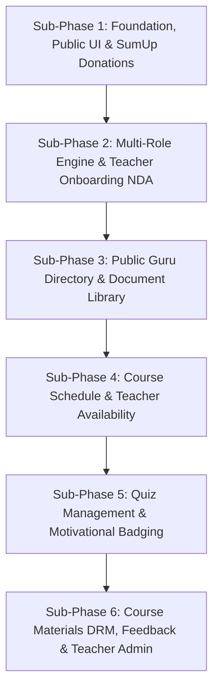

# 📋 Product Requirements Document (PRD): Phase 2 Enterprise Revamp
> **Project**: eYogi Platform & SSH Gurukul University Ecosystem  
> **Target Version**: Phase 2.0 (Enterprise Grade)  
> **Author**: Antigravity Technical Architecture & Product Team  
> **Date**: October 20, 2026  
> **Status**: Approved for Architecture & Implementation  

---

## 1. Executive Summary & Strategic Objectives

The eYogi Ecosystem is unified onto a **single, unified Supabase backend**:
1. **eYogi Main Web Platform** (Next.js 15.1.9, React 19) consuming content directly from Supabase via server components and ISR.
2. **SSH Gurukul University LMS & Custom CMS** (Vite 7.2.2, React 18, Supabase PostgreSQL, Realtime, Storage) housing all portal functionality and the consolidated Custom CMS in `/admin/*`.
*(Neon PostgreSQL and PayloadCMS are decommissioned).*

1. **eYogi Public Portal Redesign**:
   - Modernized public interface (Home, About, Donation, Blog, FAQs).
   - **Removal of separate Contact Us page** in favor of an omnipresent **WhatsApp Sticky Action Button** on the bottom right of the screen.
   - **Automated Donation Engine**: Mandatory collection of *First Name, Last Name, Email, and Phone* prior to initiating SumUp/Stripe checkout session, automated personalized welcome email with PDF tax receipt attachment, and PCI DSS/GDPR-compliant administrative ledger.
2. **Automated Teacher Onboarding & Mandatory NDA Workflow**:
   - Admin upload and management of default mandatory documents (e.g. standard NDA, Safeguarding Policy) and teacher-specific documents.
   - Enforced pre-activation workflow: Registration data capture $\rightarrow$ electronic NDA signature $\rightarrow$ administrative verification & approval $\rightarrow$ automated unlock for course assignment.
3. **Public-Facing "Guru" / Teachers Directory & Profile System**:
   - Public Header Menu access to Teachers/Gurus directory.
   - Tile/grid listing with modal overlays for extended bio (150-200 words), credentials, key achievements, teaching specialty tags, extracurricular involvement, and contact options with JSON-LD Person schema.
   - Teacher self-service profile editor and Admin management with immediate database reflection.
4. **Enterprise Document Library**:
   - Centralized repository for DOCX, PPT, PDF, and image assets with version control, tagging, full-text search, and dynamic assignment to entities (Teachers, Volunteers, Members) as onboarding workflow triggers.
5. **Bidirectional Course & Student Feedback Loops**:
   - Teacher-to-student feedback per course/batch visible to Business Admin, Parent, and Student.
   - Post-completion parent-to-course feedback visible to Teachers and Business Admin.
6. **Comprehensive Quiz Management System**:
   - Teacher creation, batch assignment (active-only validation), cloning, grading, and automatic badge issuance for scores $>80\%$.
   - Student/parent quiz taking, save-and-submit-later drafts, authenticated direct link routing, and email triggers.
7. **Schedule & Availability Management (Admin & Teacher Portals)**:
   - Calendar views (Day, Week, Month, Year) with automated batch session generation and real-time conflict identification.
   - Teacher availability management (specific & recurring slots, unavailabilities) with proactive batch assignment conflict prevention.
8. **Secure Course Material Authoring & Consumption**:
   - Admin template definition, teacher drafting and submission, admin review (Approve/Changes Requested).
   - Secure in-portal viewer with context menu (right-click) disabled, download/save controls suppressed, and embedded external video streaming.
9. **The Multi-Role Model & Teacher Admin Operations**:
   - Seamless role switching (Parent, Student, Teacher, Teacher Admin, Business Admin, Super Admin) under a single identity.
   - Dedicated 11-module operational suite for Teacher Admins.

---

## 2. User Personas & The Multi-Role Identity Architecture

### 2.1 User Personas
| Persona | Description & Core Responsibilities |
| :--- | :--- |
| **Student** | Enrolled learner accessing course materials securely, taking quizzes, saving drafts, earning badges for $>80\%$ scores, and receiving teacher feedback. |
| **Parent** | Manages enrolled children, monitors attendance and grades, reviews teacher feedback, provides post-course feedback, executes COPPA/GDPR consents. |
| **Teacher (Guru)** | Manages public Guru profile, sets recurring availability, creates quizzes for active batches, grades submissions, authors course materials, gives student feedback. |
| **Teacher Admin** | Academic operational coordinator managing master schedules, teacher availability, course assignments, batch allocations, and compliance checks. |
| **Business Admin** | Oversees financial ledgers, SumUp payment reconciliation, automated invoices, donation records, course material approvals, and executive reports. |
| **Super Admin** | Root administrator controlling system configuration, document library templates, role provisioning, and audit trails. |
| **Member / Volunteer / AD** | Subscribes to membership tiers or applies for seva (volunteer) roles, executing mandatory agreements via embedded document modals. |

### 2.2 Multi-Role Engine Requirements
- **Unified Identity**: Single authentication account across `eyogi` and `ssh` backed by Supabase Auth and linked PostgreSQL records.
- **Concurrent Roles**: A user can simultaneously hold multiple roles (e.g., Parent + Teacher + Student).
- **Active Role Switching Context**: The navigation bar contains an interactive **Role Switcher Dropdown** whenever a user holds $>1$ role. Switching context immediately re-routes the dashboard view and updates permission boundaries without requiring re-authentication.

---

## 3. Detailed Functional Modules & User Stories

```
Phase 2 Functional Scope Breakdown:
├── Module 1: eYogi Public Portal Redesign & WhatsApp Sticky Action Button
├── Module 2: Automated SumUp / Stripe Donation Flow & Tax Receipts
├── Module 3: Teacher Onboarding, Default Documents & Mandatory NDA Workflow
├── Module 4: Public Guru / Teachers Directory & Profile Management
├── Module 5: Enterprise Document Library & Workflow Triggers
├── Module 6: Bidirectional Feedback Engine (Teacher-to-Student & Parent-to-Course)
├── Module 7: Comprehensive Quiz Management (Teacher, Student & Parent Workflows)
├── Module 8: Course Schedule Management (Admin & Teacher Workflows)
├── Module 9: Teacher Availability Management (Teacher & Admin Portals)
├── Module 10: Course Material Lifecycle (Templates, Review, Secure Viewer)
└── Module 11: Teacher Admin Operational Suite (11 Modules)
```

---

### Module 1: eYogi Public Portal Redesign & WhatsApp Action Button

#### 1.1 Public Pages Overhaul
- **Home Page**: High-performance hero section, upcoming Satsangs ticker, Gurukul courses spotlight, and social proof.
- **About Us**: Guru Parampara (lineage) tree, educational mission, leadership bios, and physical center locations.
- **Blog & Wisdom Hub**: Lexical rich-text articles, search filters, category tags, and social share triggers.
- **FAQs**: Accordion-based categorized questions with live search.
- **Removal of Contact Us Page**:
  - The standalone `/contact` page is **deprecated and removed** from navigation menus.
  - An omnipresent **WhatsApp Sticky Floating Action Button** is positioned on the bottom right of all public screens (`bottom-6 right-6 z-50`).
  - Clicking the WhatsApp button opens a pre-configured chat with the official Gurukul support number (`https://wa.me/<number>?text=Namaste%20eYogi%20Gurukul...`).
  - Mobile-responsive, non-intrusive z-index overlay with accessible tooltip ("Chat with us on WhatsApp").

---

### Module 2: Automated SumUp / Stripe Donation Flow & Tax Receipts

#### 2.1 Donor Checkout Journey
1. **Amount Selection**:
   - Donor chooses from preset tier buttons ($25, $50, $100, $250, $500) or enters a Custom Amount.
   - Selects frequency (One-time or Monthly recurring).
2. **Mandatory Donor Data Collection**:
   - Before launching the payment gateway, the frontend form strictly validates and collects:
     * **First Name** (Required, min 2 chars)
     * **Last Name** (Required, min 2 chars)
     * **Email Address** (Required, RFC 5322 compliant)
     * **Phone Number** (Required, E.164 international format)
     * Optional: Cause / Dedication note (e.g. Annadana, Temple Preservation, Student Scholarship).
     * Optional: Gift Aid / Tax-exemption declaration checkbox.
3. **Gateway Session Launch**:
   - Submits payload to `/api/donations/checkout`.
   - Server registers pending donation record in Neon PostgreSQL (`donation-records` collection) and initiates checkout session (SumUp / Stripe).
   - Donor completes transaction via secure hosted modal or card widget supporting Apple Pay, Google Pay, and Credit/Debit cards.
4. **Post-Payment Automation**:
   - Gateway webhook confirms successful payment capture.
   - Server generates an official, sequentially numbered Charitable Tax Receipt PDF using `pdf-lib`.
   - Dispatches a personalized welcome & thank-you email with the attached PDF receipt containing: *Donor's Full Name, Amount, Currency, Date, and Gateway Transaction ID*.
5. **Administrative Donation Ledger**:
   - Secure Admin Dashboard at `/admin/donations` allowing Business Admins to search, filter by date/amount/cause, view details, and export records to CSV/Excel.
   - Full compliance with **PCI DSS** (no raw card data stored) and **GDPR**.

---

### Module 3: Teacher Onboarding, Default Documents & Mandatory NDA Workflow

#### 3.1 Document Upload & Association by Admin
- Business Admin / Super Admin can upload **Default Documents** in the Document Library that must be acknowledged/signed by *all* newly registering teachers (e.g., Standard Non-Disclosure Agreement, Child Safeguarding Code of Conduct).
- Admin can also assign **Specific Documents** to individual teachers based on their role, gurukul location, or specialization.

#### 3.2 Mandatory NDA Signing Workflow (Gherkin Scenarios)

```gherkin
Feature: Automated Teacher Onboarding and Mandatory NDA Workflow

Scenario: Teacher completes initial registration and is prompted for NDA
  Given a new user initiates registration as a "Teacher"
  When the teacher submits their basic profile, credentials, and contact information
  Then the system should save the registration in a "Pending Verification" state
  And the system should immediately present the mandatory NDA document within an embedded signing modal
  And the teacher cannot access any teaching dashboards or course assignments

Scenario: Teacher electronically signs the NDA
  Given the teacher is viewing the mandatory NDA modal
  When the teacher reviews the agreement, enters their legal name, and confirms the electronic signature
  Then the system should store the signed NDA with timestamp and IP address
  And the teacher's status should update to "Pending Admin Approval"
  And the teacher portal should display a message stating "Your NDA has been received. Account is awaiting Admin verification."

Scenario: System blocks course assignment prior to Admin approval
  Given a teacher has signed the NDA but has not yet been approved by an Admin
  When a Business Admin or Teacher Admin attempts to assign this teacher to an active course or batch
  Then the system must prevent the assignment
  And display an alert: "Teacher cannot be assigned to courses until account is verified and approved"

Scenario: Admin reviews, verifies NDA, and approves Teacher account
  Given a Business Admin or Super Admin accesses Teacher Onboarding Approvals
  When the Admin verifies the submitted credentials and confirms the signed NDA document
  And the Admin clicks "Approve Teacher Account"
  Then the teacher's status must transition to "Active"
  And the system must automatically generate a unique "teacher_code"
  And the teacher should immediately become eligible for course and batch assignments across Gurukul platforms
  And an automated welcome email with login credentials should be dispatched to the teacher
```

---

### Module 4: Public Guru / Teachers Directory & Profile Management

#### 4.1 Feature Specifications
- Publicly accessible via the main website Header Menu (`/gurus` or `/teachers`).
- Fast server-side rendering from PostgreSQL with indexed lookups on active status.
- Grid/tile view showing high-resolution professional headshot (with accessible alt-text) and full name.
- Clicking any tile launches a rich modal overlay displaying:
  * Engaging bio (150-200 words, active voice).
  * Bulleted summary of certifications, degrees, and licenses (with institutions and dates).
  * "Key Achievements" section (awards, publications, special projects).
  * Teaching specialties and grade/subject focus rendered as clickable filter tags.
  * Extracurricular involvement (clubs, mentorships, community seva).
  * Contact options (email link, optional calendar booking trigger).
  * JSON-LD Person structured schema markup for SEO.

#### 4.2 Gherkin Behavioral Scenarios

```gherkin
Feature: Public Teachers Directory and Profile Management

Scenario: Public user views the Teachers directory
  Given a public user navigates to the public "Teachers" page
  When the page loads successfully
  Then the user should see a list of active teachers displayed in a grid or tile format
  And each individual tile must display the respective teacher's profile picture and full name

Scenario: Public user views detailed teacher information
  Given a public user is viewing the tile list on the public "Teachers" page
  When the user clicks on a specific teacher's tile
  Then a modal overlay must appear on the screen without navigating away from the page
  And the modal must display the teacher's extended details, specifically their credentials and brief bio

Scenario: Teacher updates their own public profile details
  Given I am logged into the teacher portal
  And I navigate to my Profile Settings or Profile Management section
  When I upload a new profile picture or update my credentials and brief bio
  And I click the "Save" button
  Then my updated profile information must be saved to the database
  And an in-portal notification should confirm the update was successful
  And the changes must instantly reflect on my tile and modal on the public Teachers page

Scenario: Admin updates a teacher's public profile details
  Given I am logged into the Business Admin or Super Admin portal
  And I navigate to the Teacher Management section
  When I select a specific teacher's profile to edit
  And I update their profile picture, credentials, or brief bio on their behalf
  And I click the "Save" button
  Then the modified profile information for that teacher must be saved to the database
  And an in-portal notification should confirm the teacher's profile was successfully updated
  And the changes must instantly reflect on that specific teacher's tile and modal on the public Teachers page
```

---

### Module 5: Enterprise Document Library & Workflow Triggers

#### 5.1 Architecture & Capabilities
- **File Format Support**: Full support for DOCX, PPT, PPTX, PDF, PNG, and JPEG.
- **Organization & Metadata**: Tagging, categorization (Legal, Academic, Operational, Safeguarding), versioning ($v1.0, v1.1$), and granular role permissions.
- **Entity Association & Automated Triggers**:
  - Documents can be mapped to trigger events:
    * *Onboarding Trigger*: Map NDA to all registering Teachers, Volunteers, or Members.
    * *Compliance Trigger*: Map annual Child Safeguarding Handbook to Teachers for mandatory annual re-signature.
    * *Academic Trigger*: Attach Course Training Manuals to specific courses for assigned teachers.
- **Audit Trails**: Immutable logging of file uploads, viewings, signature timestamps, and IP addresses.

---

### Module 6: Bidirectional Feedback Engine

#### 6.1 Teacher-to-Student Course Feedback
- **Workflow**: For any active or completed course/batch, a Teacher can author detailed evaluative feedback for each enrolled student.
- **Visibility Matrix**:
  - **Student**: Visible on their Student Dashboard under course progress.
  - **Parent**: Visible on Parent Dashboard under the child's academic record.
  - **Business Admin / Teacher Admin**: Accessible via the Course Analytics & Student Records view.

#### 6.2 Parent-to-Course Feedback
- **Workflow**: Following batch completion, the parent receives an in-portal notification and email prompting feedback on the course, syllabus, and teacher effectiveness.
- **Visibility Matrix**:
  - **Assigned Teachers**: Can review aggregated ratings and constructive commentary.
  - **Business Admin & Super Admin**: Can view all ratings, instructor scores, and sentiment metrics for quality control.

---

### Module 7: Comprehensive Quiz Management

#### 7.1 Teachers Workflow (Gherkin Scenarios)

```gherkin
Feature: Quiz Management - Teachers Workflow

Scenario: Teacher creates and publishes a quiz to an active batch
  Given I am logged into the teacher portal
  And I navigate to the Quiz Management section
  And I have selected an "Active" batch
  When I create a new quiz with questions and click on the "Publish" button
  Then the quiz metadata, questions, and "Published" status must be saved to the database
  And the quiz should be visible on the dashboards of all students and parents in that batch
  And an email notification with a link to the quiz should be sent to the registered email IDs

Scenario: Teacher attempts to publish a quiz to an inactive batch
  Given I am logged into the teacher portal
  When I attempt to select an "Inactive" batch to publish a new quiz
  Then the system should prevent the selection
  And display an error message stating "Quizzes can only be sent to active batches"
  And no publish record should be committed to the database

Scenario: Teacher grades the quiz and system auto-calculates score
  Given I am logged into the teacher portal
  And I open a student's submitted quiz
  When I mark answers as "Correct" or "Incorrect" (with optional correct answers provided)
  And I click "Save & Submit"
  Then the graded record and feedback must be saved to the database
  And the system must automatically calculate the student's percentage score based on the correct answers
  And the calculated final score and feedback must become visible on the student/parent portal

Scenario: System automatically assigns a badge for scores over 80%
  Given the system has just automatically calculated a graded quiz score
  When the calculated score is strictly greater than 80%
  Then the system must assign a motivational badge to the student's profile in the database
  And the new badge must be prominently displayed on the student and parent portal dashboards

Scenario: Teacher clones an existing quiz for a future batch
  Given I am logged into the teacher portal
  When I select an existing quiz and click "Clone"
  Then a new, duplicate draft of the quiz must be saved to the database with a unique ID
  And I should be able to edit the questions and assign this cloned quiz to a new "Active" batch
```

#### 7.2 Student and Parent Workflow (Gherkin Scenarios)

```gherkin
Feature: Quiz Management - Students and Parents Workflow

Scenario: Student/Parent clicks the quiz link from the email unauthenticated
  Given I am a student or parent who is not currently logged into the portal
  When I click the quiz link from my email notification
  Then I should be redirected to the login page
  When I successfully enter my credentials
  Then I should be directly routed to the specific quiz page

Scenario: Student/Parent saves the quiz to submit later
  Given I am logged into the student/parent portal
  And I am on an active quiz page
  When I enter answers for some or all of the questions
  And I click the "Save and submit later" button
  Then my current answers and a "Draft" status must be saved to the database
  And the teacher should not yet receive a notification

Scenario: Student/Parent submits the quiz
  Given I am logged into the student/parent portal
  And I have completed the quiz questions
  When I click the "Save & Submit" button
  Then the final answers and a "Submitted" status must be saved to the database
  And an email notification should be sent to the Teacher's registered email ID
  And the submitted quiz should appear in the Teacher's portal against that student's record
```

---

### Module 8: Course Schedule Management (Admin & Teacher Workflows)

#### 8.1 Admin Portal Capabilities (Gherkin Scenarios)

```gherkin
Feature: Course Schedule Management - Admin Portal

Scenario: View Course Schedule Calendar
  Given the Business Admin or Super Admin accesses Course Schedule Management
  When the user opens the calendar
  Then the system should display all scheduled course sessions in a calendar format
  And the calendar should provide a consolidated view of all scheduled activities
  And the user should be able to identify the course, batch, teacher, date, and time of each session

Scenario: View Schedule across Day, Week, Month, and Year Views
  Given the user is viewing the Course Schedule calendar
  When the user toggles between Day, Week, Month, or Year views
  Then the calendar should render sessions according to the selected granularity
  And overlapping sessions should be clearly identifiable
  And available and occupied teaching slots should be visibly distinguishable

Scenario: Automatically Include Active Batches and Generate Schedule Entries
  Given there are active batches available in the system
  When the schedule generation process is triggered
  Then the system should automatically generate relevant schedule entries for active batches
  And inactive or completed batches should not be available for schedule creation by default
  And generated sessions should immediately appear on the calendar and be visible to assigned teachers

Scenario: Identify Schedule Conflicts during Creation or Editing
  Given the Business Admin or Super Admin is creating or editing a course schedule
  When the selected teacher already has another scheduled session during the same time period
  Then the system should identify the scheduling conflict
  And notify the user before saving the schedule
```

#### 8.2 Teacher Portal Capabilities (Gherkin Scenarios)

```gherkin
Feature: Course Schedule Management - Teachers Workflow

Scenario: Teacher Views Assigned Schedule
  Given a teacher is logged into the system
  When the teacher accesses their schedule or calendar
  Then the system should display all course sessions assigned to that teacher
  And the teacher should only see schedules relevant to them
  And the teacher should be able to view the schedule in Day, Week, Month, and Year views

Scenario: Teacher Views Automatically Generated Batch Schedule
  Given a teacher is assigned to an active batch
  When schedules are automatically generated for that batch
  Then the generated sessions should automatically appear in the teacher's schedule
  And the teacher should not need to manually create the schedule

Scenario: Navigate and Filter Calendar
  Given the user is viewing the Course Schedule calendar
  When the user navigates between Previous, Next, or Today
  Or applies filters such as Course, Batch, Teacher, or Status
  Then the calendar should accurately display the matching scheduled sessions
```

---

### Module 9: Teacher Availability Management

#### 9.1 Teacher Portal Workflow (Gherkin Scenarios)

```gherkin
Feature: Availability Management - Teacher Portal

Scenario: Teacher Views Availability Calendar
  Given the teacher is logged into the Gurukul system
  When the teacher accesses the My Availability section
  Then the system should display the teacher's availability calendar
  And display available, unavailable, and already scheduled time slots

Scenario: Teacher Adds Specific or Recurring Availability
  Given the teacher is viewing the My Availability section
  When the teacher configures specific date/times or recurring weekly patterns
  (e.g., Monday 17:00-20:00, Wednesday 17:00-20:00, Saturday 10:00-14:00)
  Then the system should save the availability and make it visible to Admins for scheduling

Scenario: Teacher Marks Specific Date as Unavailable or Deletes Availability Slot
  Given the teacher has existing availability configured
  When the teacher marks a date as unavailable or deletes an availability slot
  Then the slot should be removed from future scheduling consideration
  And the system should notify Admins if an existing future session is now in conflict
```

#### 9.2 Admin Portal Workflow (Gherkin Scenarios)

```gherkin
Feature: Availability Management - Admin Portal

Scenario: Business Admin Views and Filters Teacher Availability
  Given the Business Admin or Super Admin accesses Teacher Availability Management
  When the user views the calendar filtered by Teacher, Course, Date, or Status
  Then the system should clearly identify available slots, unavailable slots, and conflicts

Scenario: Consider Teacher Availability While Creating a Batch or Schedule
  Given the Admin is assigning a teacher to a proposed batch or session schedule
  When the proposed time falls outside the teacher's configured availability
  Then the system should display an availability warning and prevent assignment without an authorized override

Scenario: Prevent Teacher Assignment on Existing Schedule Conflict
  Given a teacher already has a confirmed session at a specific date and time
  When an Admin attempts to assign the teacher to another batch during that time
  Then the system should block the assignment and prevent overlapping schedules
```

---

### Module 10: Course Material Creation & Secure Consumption

#### 10.1 Template Definition & Review Lifecycle (Gherkin Scenarios)

```gherkin
Feature: Course Material Template Definition and Approval Workflow

Scenario: Business Admin defines a course material template
  Given I am logged into the Business Admin portal
  And I navigate to the Course Settings section
  When I configure and save a UI-based course material template
  Then the template structure must be saved to the database
  And become available for assigned teachers when no course materials exist

Scenario: Teacher drafts and submits course material using the template
  Given I am logged into the teacher portal
  And I navigate to an assigned course with no uploaded materials
  When I initialize the material using the defined template and submit for review
  Then the material status must update to "Pending Approval"
  And an email notification and in-portal alert must be dispatched to Business and Super Admins

Scenario: Admin approves or rejects the submitted course material
  Given I am logged into the Admin portal reviewing a "Pending Approval" submission
  When I click "Approve"
  Then the material status must become "Published" and available for course delivery
  When I click "Reject" with mandatory feedback
  Then the material status must become "Changes Requested" and notify the teacher for resubmission
```

#### 10.2 Secure Material Consumption & DRM Controls (Gherkin Scenarios)

```gherkin
Feature: Secure Course Material Consumption

Scenario: Teacher views file-based course material securely
  Given I am logged into the teacher portal
  And I navigate to my assigned course
  When I select an uploaded course material (PDF, PowerPoint, or Image)
  Then the material must render directly within a viewer in the portal
  And the native browser context menu (right-click) should be disabled on the viewer
  And no "Download" or "Save As" buttons should be available or visible to the teacher

Scenario: Teacher accesses an external video link
  Given I am logged into the teacher portal
  And I navigate to my assigned course
  When I select a video course material sourced from an external link
  Then the video should play within an embedded frame or secure viewer within the portal
  And the portal must not provide any native controls or buttons to download the video locally

Scenario: Admin manages file-based uploads and external video links
  Given I am logged into the admin portal
  When I upload a supported file (PDF, PPT, Image), it must be securely stored in Supabase storage with database references
  When I provide an external video link (YouTube, OneDrive), it must save directly to the database without Supabase storage upload
```

---

### Module 11: The Teacher Admin Operational Suite

The **Teacher Admin** role bridges academic instruction and administrative governance:
1. **Operational Dashboard**: Real-time batch metrics, teacher availability ratios, attendance alerts.
2. **Student Directory**: Student roster, enrollment approvals, batch transfers, and performance records.
3. **Teacher Management**: Teacher profiles, qualification records, availability tracking, and workload balancing.
4. **Curriculum & Courses**: Course catalogs, prerequisite trees, syllabus revisions.
5. **Course Assignment**: Drag-and-drop teacher-to-course and teacher-to-batch assignment matrix.
6. **Schedule Management**: Day/Week/Month/Year schedule generation, room/Zoom allocation.
7. **Availability Management**: Teacher shift tracking, recurring availability patterns, and substitute allocation.
8. **Certificates Queue**: Automated eligibility audits and bulk certificate approvals.
9. **Batch Management**: Batch creation, capacity capping, pricing tiers, and start/end timelines.
10. **Compliance & Safeguarding**: DBS check validity, safeguarding certifications, and parental consent logs.
11. **Gurukul Cluster Management**: Multi-center physical and virtual classroom allocations.

---

## 4. Grounding in Active Codebase & Database Architecture

Every requirement in this PRD is mapped to the existing project structures, databases, and dependencies without breaking backwards compatibility:

### 4.1 Project 1 Context: eyogi (Next.js 15 App Router Frontend on Unified Supabase)
- **Supabase-Driven Public Pages**: Public pages in `src/app/(frontend)/` fetch content directly from Supabase (`page_settings`, `dynamic_menus`, `blog_posts`, `faqs`) using server components and ISR.
- **Decommissioned Dependencies**: Neon PostgreSQL (`DATABASE_URI`) and PayloadCMS (`@payloadcms/*`) are removed, simplifying the architecture.
- **Active Routing & Layout**: Public pages live in `src/app/(frontend)/`. The deprecated `/contact` page is removed and replaced by `WhatsAppStickyButton.tsx` in `src/app/(frontend)/layout.tsx`.
- **Donation Processing**: Next.js API `/api/donations/*` handles SumUp/Stripe checkout and webhooks, writing transactions directly into Supabase `donation_records`.


### 4.2 Project 2 Context: ssh (`src/SSH` Vite 7 + React 18 + Supabase PostgreSQL)
- **Active Tables & Schemas Utilized**:
  - `public.teachers`, `public.courses`, `public.batches`, `public.course_assignments`, `public.enrollments`, `public.attendance`, `public.parent_children`, `public.profiles`.
  - Field encryption via `src/SSH/src/lib/encryption.ts` for all minor student and parent data.
- **Active Navigation & Components Extended**:
  - `AdminSidebar.tsx`: Grouped into 6 categories (Academic Operations, Users & Identity, Financials, Assets, Governance, Reports).
  - `InvoiceManagement.tsx` & `PaymentManagement.tsx`: Upgraded from `ComingSoon` placeholders to fully functional modules.
  - `src/SSH/src/contexts/AuthContext.tsx`: Extended to `MultiRoleContext.tsx` supporting concurrent role switching.

---

## 5. Phase 2 Implementation Roadmap (6 Structured Sub-Phases)

To ensure enterprise-grade delivery, zero downtime, and systematic quality assurance, implementation is structured into **6 discrete Sub-Phases**:



### Sub-Phase 1: Foundation, Public Portal Redesign & Automated SumUp Donations
- **Scope**:
  - Public UI overhaul (Home, About, Blog, FAQs).
  - Deprecate `/contact`; implement fixed `WhatsAppStickyButton.tsx` on bottom right.
  - Create PayloadCMS collection `DonationRecords` in Neon PostgreSQL.
  - Frontend donation form collecting *First Name, Last Name, Email, Phone*, amount, and dedication.
  - Next.js API `/api/donations/checkout` launching SumUp/Stripe session.
  - Webhook listener `/api/donations/sumup-webhook` with HMAC signature verification.
  - Automated PDF tax receipt generator (`pdf-lib`) and email delivery worker.
  - Admin donation ledger with CSV/Excel export.

### Sub-Phase 2: Multi-Role Identity Engine & Teacher Onboarding with Mandatory NDA
- **Scope**:
  - Supabase schema migration: `user_roles` association table with `app_role` enum.
  - `MultiRoleContext.tsx` and top-bar Role Switcher dropdown for seamless context switching without logout.
  - Admin default document management in `document_library` (Standard NDA, Safeguarding agreements).
  - Teacher registration flow with embedded electronic NDA signing modal.
  - Database trigger `trg_validate_teacher_assignment` preventing unapproved teachers from course assignments.
  - Admin Teacher Onboarding verification & approval interface (`teacher_code` generation).

### Sub-Phase 3: Public Guru Directory, SEO Profiles & Enterprise Document Library
- **Scope**:
  - Public `/gurus` and `/teachers` directory with tile grid and rich modal overlay (150-200 word bio, credentials, achievements, specialty tags).
  - `JSON-LD Person` structured data schema generator for SEO.
  - Teacher self-service profile management and Admin CRUD (`GuruManagement.tsx`) with image upload/resize.
  - Supabase table `document_library` supporting DOCX, PPT, PDF, PNG, JPG with versioning and full-text search.
  - `document_assignments` engine mapping documents to signup and compliance workflow triggers.

### Sub-Phase 4: Course Schedule & Teacher Availability Management
- **Scope**:
  - Supabase schemas: `teacher_availability` (specific & recurring slots) and `course_schedules`.
  - Teacher Availability Portal: Manage availability, mark dates unavailable, view assigned sessions alongside available slots.
  - Admin Master Schedule Calendar across Day, Week, Month, and Year views.
  - Automated session generation for active batches.
  - Real-time conflict detection engine (`check_schedule_conflict`) preventing teacher double-booking and checking availability during batch creation.

### Sub-Phase 5: Quiz Management System & Motivational Badging Engine
- **Scope**:
  - Supabase schemas: `quizzes`, `quiz_questions`, `quiz_attempts`, `student_badges`.
  - Teacher Quiz Creator: Active batch enforcement (blocks inactive batches), automated email alerts with direct links.
  - Student/Parent Quiz Runner: Unauthenticated deep-link handling via login redirect, draft saving, final submission.
  - Grading Engine: Automatic score percentage calculation, and automated badge awarding strictly for scores $>80\%$ displayed on student/parent dashboards.
  - Quiz cloning mechanism for future active batches.

### Sub-Phase 6: Course Materials (DRM), Bidirectional Feedback & Teacher Admin Suite
- **Scope**:
  - Course Material lifecycle: Admin UI template builder, teacher drafting & review queue (Approve/Changes Requested).
  - Secure In-Portal Viewer: Disabled right-click context menu, suppressed download/save buttons, embedded external video streaming (YouTube/OneDrive) without file storage overhead.
  - Bidirectional Feedback: `student_course_feedback` (Teacher-to-Student) and `parent_course_feedback` (Parent-to-Course) with role-restricted visibility.
  - Dedicated Teacher Admin Portal with 11 operational modules.
  - Full implementation of `InvoiceManagement.tsx` and `PaymentManagement.tsx` replacing `ComingSoon` placeholders.

